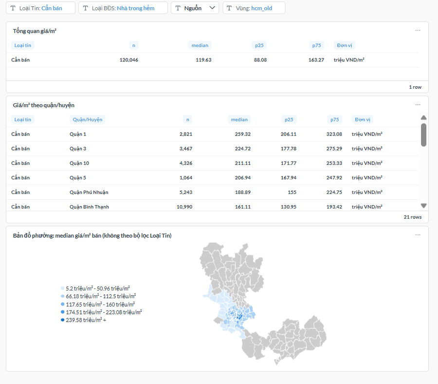
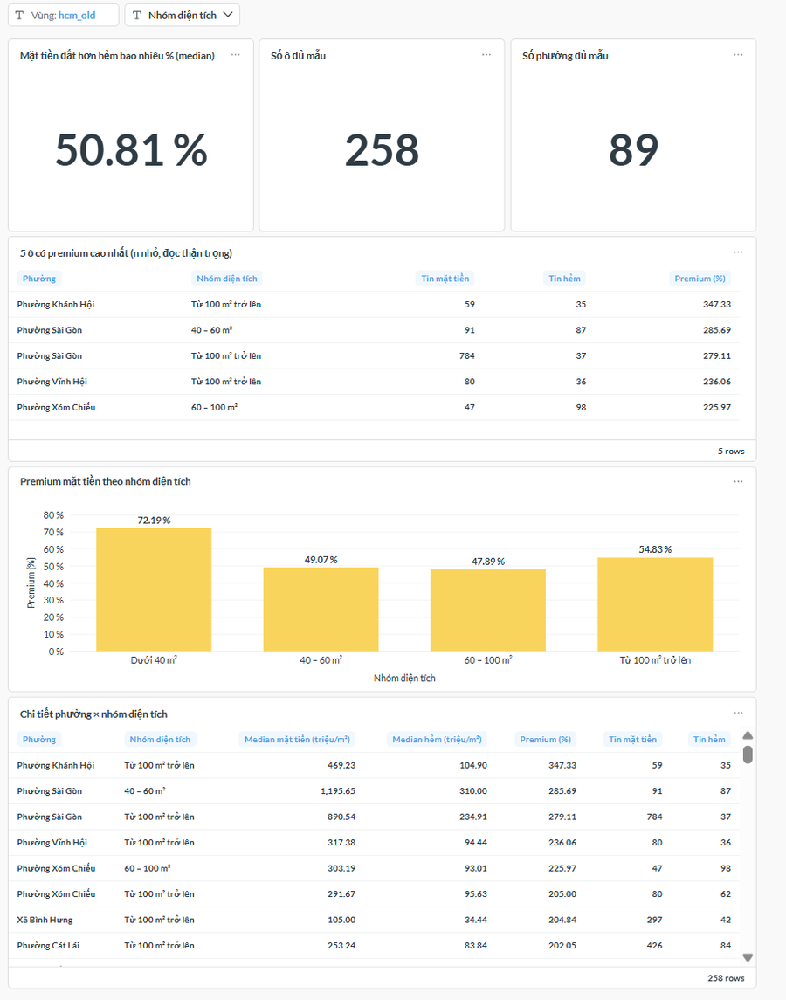
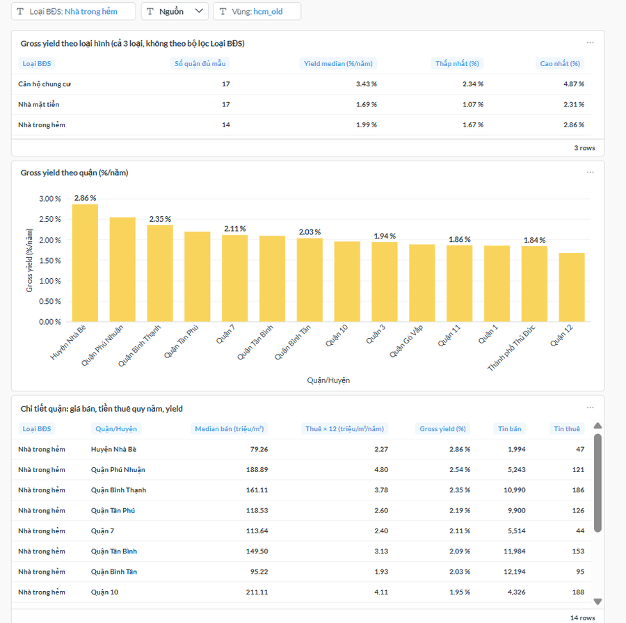
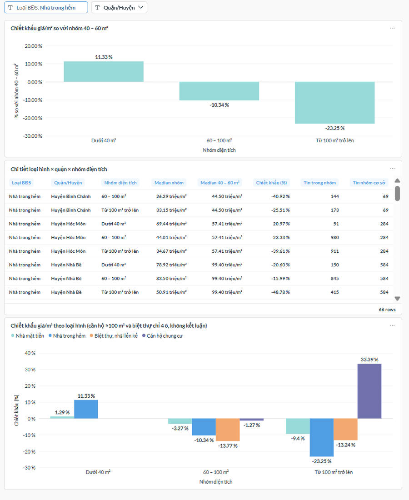
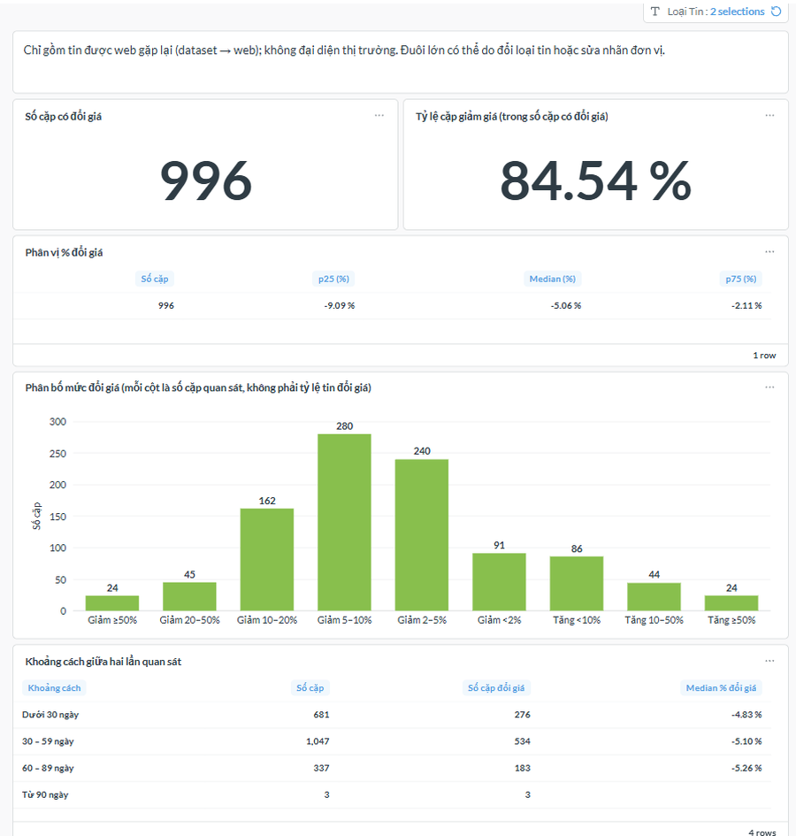
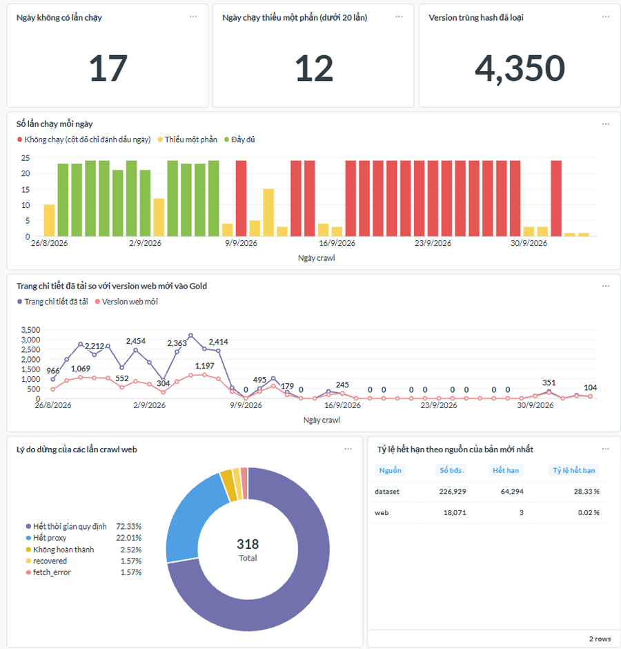
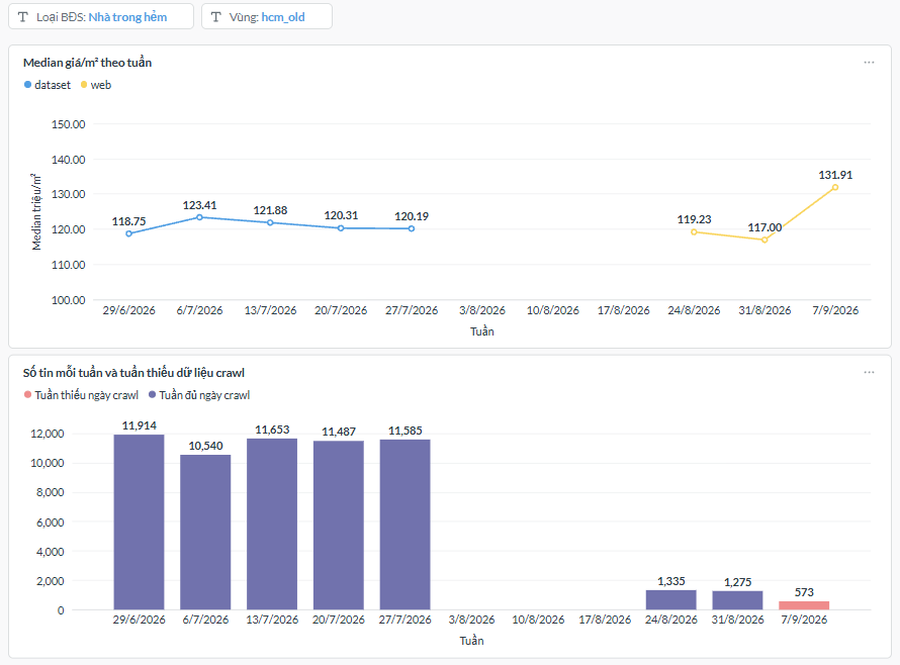

# analytics/ — Analytics Layer for RealEstateDW

🇬🇧 English (this file) · 🇻🇳 [Tiếng Việt](README.vi.md)

Back to the main project README (Data Engineering pipeline): [../README.md](../README.md)

## 1. Overview

RealEstateDW crawls listings from alonhadat.com.vn into a Medallion warehouse (Bronze, Silver, Gold). Gold is clean but does not yet answer BI questions: price per m² by area, how much more a frontage house costs than an alley house, rental yield, and how far the data can be trusted.

`analytics/` adds a **read-only analytics layer over Gold** (3 PostgreSQL views) and a **7-tab Metabase dashboard**. Each tab answers one question.

- Gold, Silver, the pipeline and the 13 existing Metabase cards are not modified. Everything lives in the `analytics` schema.
- Medians instead of means; groups with n < 30 are hidden; limitations are stated explicitly.

## 2. Architecture

```
alonhadat.com.vn
      |
      v
  Bronze (S3, Parquet) --> Silver (SCD2) --> Gold: gold.vw_fact_report
                                                      |
  pipeline.run_state (DAG 2 run history)              |  (read-only)
            |                                         |
            v                                         v
        +---------------------------------------------------+
        |  schema analytics (3 views)                       |
        |  - vw_listing_latest   (1 row per listing)        |
        |  - vw_listing_versions (deduplicated versions)    |
        |  - vw_crawl_coverage   (1 row per crawl day)      |
        +---------------------------------------------------+
                              |
                              v
                  Metabase: 7-tab dashboard (Q1-Q7)
```

| View | Grain | Role |
|---|---|---|
| `vw_listing_latest` | 1 row per listing (the version with `MAX(valid_from)`) | All flags and filter rules in one place; `is_analysis_ready` is the single filter column for price per m² |
| `vw_listing_versions` | 1 row per real version of a listing | Consecutive duplicate-hash versions removed; used by Q5 |
| `vw_crawl_coverage` | 1 row per day, including days with no run | "Missing data day" mask for Q6 and Q7 |

Columns: [`docs/data_dictionary.md`](docs/data_dictionary.md).

## 3. Dashboard: 7 Tabs

Metabase collection "Analytics" (the dashboard UI is in Vietnamese). The SQL of each card is in `sql/cards/`, identical to what runs on Metabase.

| Tab | Question | Key result | SQL |
|---|---|---|---|
| Q1 Price levels | Price per m² by area, property type, sale/rent | Alley house (Nhà trong hẻm), for sale (Cần bán), hcm_old: median 119.63 million VND/m² (p25 88.08; p75 163.27; n 120,046) | `q1_price_level.sql` |
| Q2 Frontage vs Alley | How much more a frontage house costs than an alley house in the same ward | hcm_old: median premium 50.81% (258 cells, 89 wards with enough data) | `q2_frontage_premium.sql` |
| Q3 Gross yield | Rental yield by district | hcm_old: alley house 1.99%/year (14 districts); apartment 3.43% (17); frontage house 1.69% (17) | `q3_gross_yield.sql` |
| Q4 Area discount | Price-per-m² discount by area | Alley house vs the 40–60 m² band: +11.33% (<40 m²), −10.34% (60–100), −23.25% (≥100) | `q4_area_discount.sql` |
| Q5 Price changes | Do listings revisited by the web change price | Both listing types: 996 pairs with a price change; 84.54% are decreases; p25 / median / p75 = −9.09 / −5.06 / −2.11 (%) | `q5_price_change.sql` |
| Q6 Reliability | How far can the data be trusted | 17 days with no run; 12 days with partial runs (under 20); 4,350 duplicate-hash versions removed | `q6_reliability.sql` |
| Q7 Weekly stability | Is the weekly price per m² stable | Dataset median 118.75 → 120.19; web 119.23 / 117.00 / 131.91; no market-trend conclusion | `q7_stability.sql` |

How to read them:
- Q5 is the distribution of price changes **among dataset → web pairs with different hashes** (14–98 days apart). It is not "x% of listings change price".
- Q7 does not join the dataset series and the web series; the two sources differ in mix and coverage.
- Q4: apartments ≥100 m² and villas have only 4 cells per group, so no conclusion is drawn.

## 4. Data Reliability: Issues Found and How They Are Handled

| Issue | Evidence | Handling |
|---|---|---|
| SCD2 merge inverted the version order in Silver | 4,850 listings with wrong `is_current` / `valid_to`; 4,350 duplicate-hash versions | Latest version = `MAX(valid_from)`; duplicates dropped in `vw_listing_versions`; pipeline left unchanged (out of scope) |
| Wrong price units and mislabeled listings | Sale < 1M VND/m²: 31 listings; rent ≥ 10M VND/m²/month: 12; rent < 10,000 VND/m²/month: 4 | Excluded by rules R1, R4, R6 |
| Wrong area (decimal point dropped, or total floor area of multi-storey houses) | 282 listings whose area is about 10× or 100× length × width | Flagged `area_suspect`, excluded from price per m² (R7) |
| Crawler off when data is not needed | 17 of 40 days with no run, 12 with partial runs | `vw_crawl_coverage` mask on Q6 and Q7; no trend conclusions |
| Two sources not comparable | The web never re-crawls old URLs: expired 28.33% (dataset) vs 0.02% (web) | Sources kept as separate series; expiry not compared |

## 5. Analysis Rules

- Median (`percentile_cont`) with p25 and p75; n is always shown; groups with n < 30 are hidden.
- Sale and rent listings are never mixed in the same calculation.
- A condition that always holds is hard-coded in SQL; a condition the viewer changes uses a Field Filter + dashboard filter (defaults set on the dashboard). Cards with a Field Filter do not alias `analytics.vw_listing_latest`.
- Every displayed number is `ROUND`ed to 2 decimals.
- Metric definitions, rules R1–R9 and time windows: [`docs/metrics.md`](docs/metrics.md).

## 6. How to Re-run

Requirements: PostgreSQL 16 with `gold.vw_fact_report` and `pipeline.run_state`; Metabase connected to this database.

1. **Create the 3 views** (PowerShell, from the project root; safe to re-run):
   ```powershell
   $env:PGCLIENTENCODING = 'UTF8'
   psql "$env:POSTGRES_DW_DSN_LOCAL" -v ON_ERROR_STOP=1 -f analytics/sql/01_create_base_views.sql
   ```
2. **Check invariants:** run `qa/02_invariants.sql`; all 4 queries should return 0 rows.
3. **Metabase:** sync the schema; for each card, create a Native query from its file in `sql/cards/`, map the Field Filters as described at the top of the file, connect the dashboard filters and set defaults per [`docs/metrics.md`](docs/metrics.md) section 4. Q1 CARD 3 needs the ward map (GeoJSON) registered in Metabase.
4. **Cross-check with pandas** (optional): export `latest_ready.csv` and `median_by_group.csv` from DataGrip into `analytics/qa/_out/`, then run `python analytics\qa\recompute_median.py`; the last line should read "KẾT QUẢ: KHỚP" (match).

What was checked and how: [`docs/qa.md`](docs/qa.md).

## 7. Known Limitations

Full list: [`docs/metrics.md`](docs/metrics.md) section 7.

1. Asking prices, not transaction prices.
2. The two sources differ in coverage and mix; the web crawl starts on 2026-08-26, with a gap from 08-14 to 08-25 and on the days the system was off. `valid_from` is the crawl date, not the Gold load date.
3. Q5 only contains dataset → web pairs with different hashes and does not represent the market; 13 suspect pairs (1.3%); the rent tab has only 89 pairs with a price change.
4. `posted_date` is most likely the latest posting or refresh date; weekly listing counts reflect the crawl schedule.
5. Price-unit errors in the middle of the distribution are not caught; `area_m2` of multi-storey houses is often total floor area.
6. `region_group` shares have not been re-measured after the second pipeline run.

## 8. Folder Structure

```
analytics/
  README.md / README.vi.md
  docs/    metrics.md, data_dictionary.md, qa.md
  sql/     01_create_base_views.sql
    cards/ q1 ... q7 (SQL of each Metabase card)
  qa/      01_ ... 06_*.sql, q5_sizing.sql, q5_qa.sql, recheck_flags_q1.sql,
           recompute_median.py, recompute_q2_cell.py
  assets/dashboard/   7 screenshots
```

## 9. Screenshots








